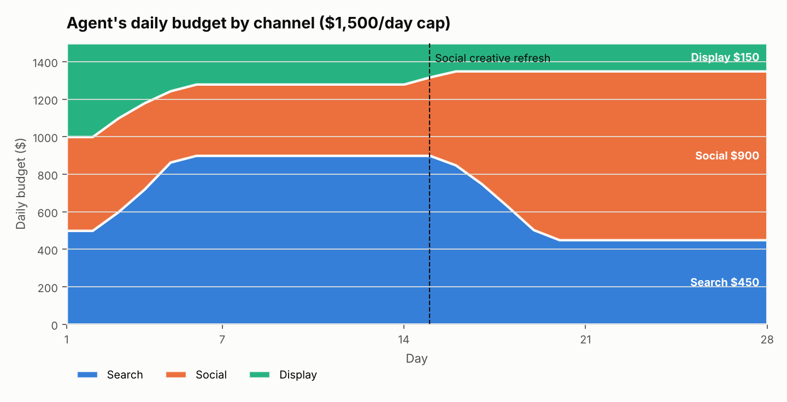
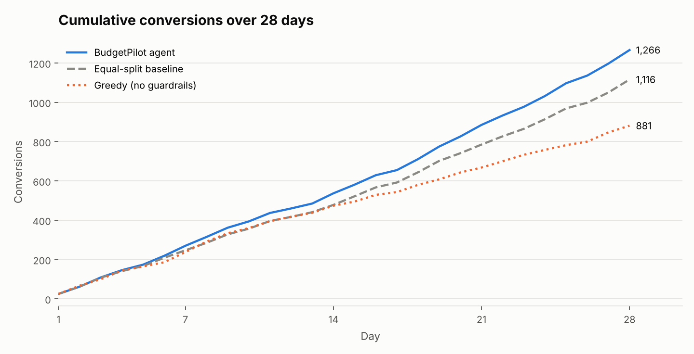

# BudgetPilot — Ad Budget Optimization Agent

**BUS4-118S Sec 02 · Group Exercise: Agentic AI in Marketing**
**Group:** Anagha Ayyagari, Shayan, Arshdeep

A minimal agent that splits a fixed **$1,500/day** ad budget across **Search, Social and Display** to
**maximize conversions**. Every morning it reads yesterday's results, recomputes CTR / CVR / CPA,
shifts 10–20% of budget toward the best-CPA channel, enforces guardrails, and logs a reason for every change.

```
read_performance ──► compute_metrics ──► propose_budget ──► apply_guardrails ──► log_decision
 (CSV, no future)    (7-day, recency-     (explore/exploit:   (±20%/day, 10% floor,   (reason string
                      weighted CPA)        +10/15/20%)          60% cap, cost cap)      per channel)
```

## Repo contents

| Path | What it is |
|---|---|
| `data/ad_performance.csv` | 28 days × 3 channels of mock data (`date, channel, spend, impressions, clicks, conversions`) |
| `data/generate_mock_data.py` | Re-creates the CSV (seeded) |
| `prompts/system_prompt.md` | The agent's system prompt: role, tools, decision rules, guardrails, output format |
| `agent.py` | The agent: 5 tools, guardrails, decision log, optional LLM advisor, baseline policies |
| `simulator.py` | Replays each day so we can test budgets that weren't actually run |
| `run_evaluation.py` | Runs agent vs. equal-split baseline, writes logs, summary and charts |
| `ad_optimization_agent.ipynb` | Notebook walkthrough with saved outputs |
| `tests/test_agent.py` | Guardrail and tool tests |
| `outputs/` | Decision log, daily results, summary.json, charts (from a successful run) |
| `docs/` | Design doc and scaling note |

## How to run

Requires Python 3.10+.

```bash
pip install -r requirements.txt
python run_evaluation.py            # runs everything, ~30 seconds
python tests/test_agent.py          # 8 guardrail/tool tests
jupyter notebook ad_optimization_agent.ipynb   # optional walkthrough
```

Options: `--csv path.csv` (your own data, same columns), `--budget 2000`, `--seed 7`,
`--elasticity 0.5`, `--seeds 100` (robustness runs), `--llm` (see below).

**Optional LLM mode.** `--llm` sends the system prompt plus that day's metrics to Claude, which
proposes the shift as JSON. Its answer is clamped to a 10–20% shift and still passes through
`apply_guardrails()`. If anything fails (no key, timeout, bad JSON) the agent falls back to the rules.
Needs `ANTHROPIC_API_KEY`; set `AGENT_LLM_MODEL` to pick a model. The default run needs no API key.

## Assumptions

- **Mock data.** Search has the best CPA in weeks 1–2; Social gets a creative refresh on day 15 and
  becomes the cheapest channel; Display is the most expensive per conversion throughout.
- **Offline replay.** To score budgets that weren't actually run, the simulator uses each day's observed
  CPM, CTR and CVR, with **diminishing returns**: impressions scale with `(spend / historical spend)^0.65`
  (elasticity 0.35). Clicks and conversions get seeded binomial noise. Every policy faces the same market and seed.
- The agent only sees data from days before the one it's deciding (no look-ahead).
- Budget is moved at the channel level only: no bids, creative or targeting changes.

## Results snapshot (seed 42, 28 days, $42,000 total spend for every policy)

| Policy | Conversions | Avg CPA | CTR | CVR |
|---|---:|---:|---:|---:|
| **BudgetPilot agent** | **1,266** | **$33.18** | 0.69% | 3.95% |
| Equal-split baseline | 1,116 | $37.63 | 0.53% | 3.31% |
| Greedy, no guardrails (ablation) | 881 | $47.67 | 2.14% | 6.51% |

- **+13.4% conversions (+150) and 11.8% lower CPA** than the equal split, with the same spend.
- **Robustness:** over 100 noise seeds the agent beat the baseline every time (mean +11.5%, range +5.3% to +18.0%).
- **Sensitivity:** uplift is +19.4% / +13.4% / +8.4% at elasticity 0.20 / 0.35 / 0.50.
  The more saturated channels are, the less there is to gain by shifting budget.
- **Why guardrails matter:** the greedy version moved 100% to Search on day 2, never saw Social improve,
  and ran into diminishing returns. It finished 21% *below* the baseline.

Sample decision log (`outputs/decision_log.csv`):

```
Day  3  Search up 20% ($500->$600) due to better CPA $28.08 vs $47.33 portfolio (41% better), CVR 7.2%, stable CPA
Day  3  Display down 20% ($500->$400) due to higher CPA $102.35; budget moved to Search
Day 16  Social up 20% ($418->$501) due to better CPA $27.95 vs $38.49 portfolio (27% better), CVR 3.2%, stable CPA
Day 16  Display down 18% ($182->$150) due to higher CPA $65.87; budget moved to Social; kept at 10% floor to keep learning
```



